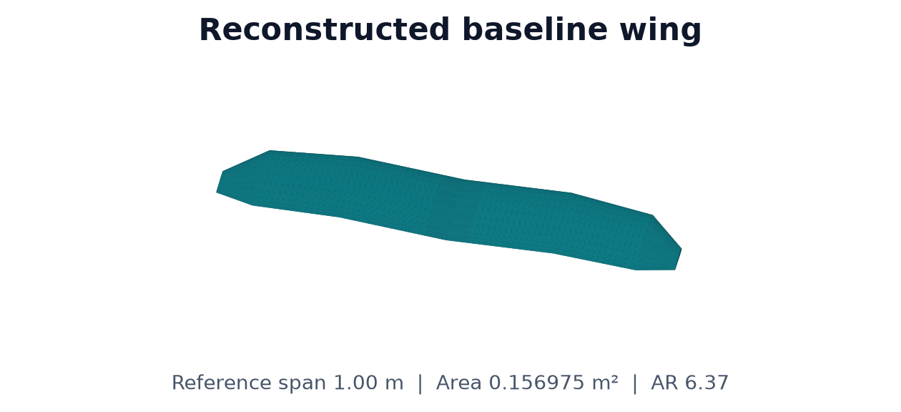
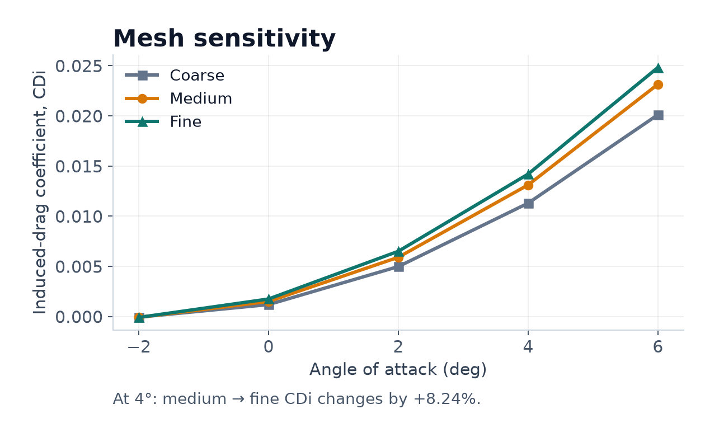
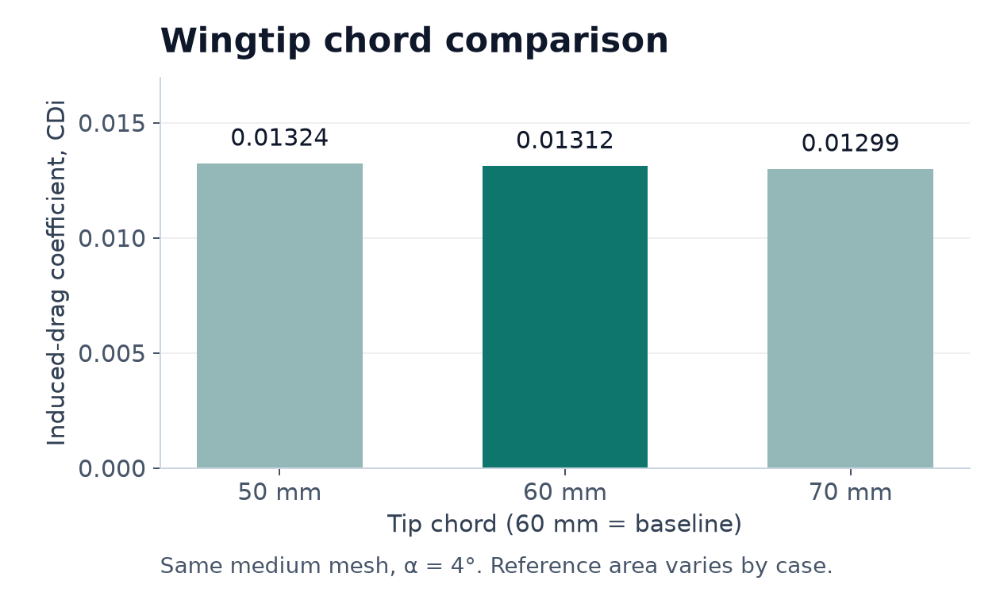

# Specter | From 3D Print to Aerodynamics

**A field-tested prototype. A reconstructed wing. Repeatable OpenVSP studies.**

I built this [Eclipson Model A](https://www.eclipson-airplanes.com/modela) using 3D printing, assembled it, and tested it in the field. Specter reconstructs its wing in **OpenVSP** and compares mesh resolution and wingtip geometry with **VSPAERO**.

<p align="center">
  <a href="assets/IMG_0046%281%29.jpg"></a>
  <a href="assets/tutorials/baseline_wing.png"></a>
</p>

*My physical prototype (left) and reconstructed wing (right). Reference span: **1.00 m** · area: **0.156975 m²** · aspect ratio: **6.37**.*

## Three runnable tutorials

| Tutorial | Run with `.venv` activated |
|---|---|
| [**1. Build the baseline wing**](tutorials/01_build_baseline.py)<br>Export the VSP3 model and geometry metrics. | `python tutorials/01_build_baseline.py` |
| [**2. Check mesh sensitivity**](tutorials/02_mesh_sensitivity.py)<br>Compare coarse, medium, and fine settings across 15 cases. | `python tutorials/02_mesh_sensitivity.py` |
| [**3. Compare wingtip chords**](tutorials/03_wingtip_geometry.py)<br>Test 50 / 60 / 70 mm tips with the same medium mesh. | `python tutorials/03_wingtip_geometry.py` |

| Mesh sensitivity | Wingtip geometry at 4° |
|---|---|
| [](assets/tutorials/mesh_sensitivity.png) | [](assets/tutorials/wingtip_comparison.png) |

**Result to notice:** at 4°, induced drag changes by **8.24%** from medium to fine mesh; convergence is still unresolved. The wingtip chart compares coefficients using each case's reference area. Click either chart to enlarge it.

Example results: **OpenVSP 3.49.0 · 30 aerodynamic cases · −2° to +6°**.
[Baseline metrics](assets/tutorials/baseline_geometry.json) · [Mesh CSV](assets/tutorials/mesh_summary.csv) · [Wingtip CSV](assets/tutorials/geometry_summary.csv) · [Convergence CSV](assets/tutorials/mesh_convergence_at_4deg.csv)

## Run in three steps

Complete the [one-time setup](docs/setup.md) first, then:

1. Open **PowerShell** in the project folder.
2. Activate the environment:

   ```powershell
   Set-ExecutionPolicy -Scope Process -ExecutionPolicy RemoteSigned
   .\.venv\Scripts\Activate.ps1
   ```

3. Run both studies:

   ```powershell
   python run_studies.py --study all
   ```

Tutorial outputs go to `results/tutorial_*`; the combined run writes to `results/`.

**Scope:** an approximate wing-only model with a provisional NACA 2412 airfoil. These numerical coefficients are preliminary and have not been validated against flight data. [Measurements and assumptions](docs/reference_aircraft.md).

Original aircraft design: **Eclipson**. Build, field testing, reconstruction, and studies: [**Pranav Rajyaguru · @pranavrajyaguru**](https://github.com/pranavrajyaguru).
